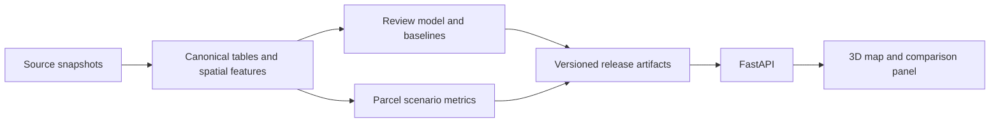

# Parcel Planner implementation plan

Build a 24–48 hour Bash of Berkeley prototype that ranks five essential-service proposals on a single San Francisco parcel. The user selects a site, previews one proposal in 3D, adjusts benefit weights, and compares need, economic scenarios, and access-related travel savings. Use SF for parcel selection and final model testing, Oakland for initial training, and Berkeley for model selection. The 3D design follows the campus-style simulator concept using SF geography.

## Architecture and shared contract

Use React, TypeScript, Vite, MapLibre GL JS, and Recharts in `frontend/`. Use Python 3.11, FastAPI, and Pydantic in `backend/`. Put pandas, GeoPandas, Shapely, PyArrow, and scikit-learn batch code in `pipeline/`. Store small synthetic fixtures and response examples in `contracts/`, category and scenario assumptions in `config/`, and audit reports in `reports/`. Ignore source downloads, large derived files, model binaries, and credentials. Lock dependencies and document a local run from a clean checkout.

Agree on candidate IDs before parallel development: `clinic`, `pharmacy`, `grocery`, `bank_credit_union`, and `school`. Use string IDs for APNs, Census GEOIDs, and place IDs. Namespace parcel IDs as `sf:<physical-lot-key>`. Use EPSG:26910 for metric geometry and WGS84 longitude/latitude for exported GeoJSON. Record area in m², distances in meters or explicitly labeled miles, annual retained sales tax in USD, and jobs in operating FTE.

## Person 1 — Frontend and simulator

1. Create a fixture-driven desktop UI. Use a pitched SF map, a parcel selector with keyboard support, a candidate list, and a comparison panel. Show the source vintage and distinguish source-indicated vacancies from hypothetical sites. Keep the parcel list and results usable if the basemap or WebGL fails.
2. Load parcel and service layers by viewport. Highlight the selected parcel, filter the service overlay by category, and place the proposed volume in a separate layer. Use an approximately 50% illustrative footprint and a fixed 7 m height across categories. Clip the preview footprint to the parcel and fall back to the outline for unusable geometry. Offer a 2D toggle and label the volume as illustrative massing. [MapLibre building extrusion example](https://maplibre.org/maplibre-gl-js/docs/examples/display-buildings-in-3d/)
3. Implement three objective sliders and a 0–2 need priority for each category. Default all values to one. Debounce comparison calls by 150 ms and abort or ignore stale responses after parcel or weight changes. Reset restores the defaults.
4. Display raw metrics with units, normalized scores, rank, Pareto status, review-activity source, uncertainty ranges, and unavailable reasons. Use a scatterplot with two available objectives on the axes and the third, if available, encoded by color. Show only actual alternatives and visually distinguish nondominated points. Show before/after access in the selected category.
5. Handle loading, empty lists, unavailable metrics, failed requests, and invalid geometry. Use the API as the source of ranking and score calculations.

**Handoff and acceptance.** Person 1 starts with the shared fixture, integrates with Person 3 by hour 24, and gives Person 4 a browser flow covering selection, preview, reweighting, reset, and errors. Check the presentation at 1440×900 and 1280×720.

## Person 2 — Data and review-activity model

### Source adapters and data checks

| Source | Grain and role | Implementation |
|---|---|---|
| [SF Land Use](https://catalog.data.gov/dataset/san-francisco-land-use) | Physical lot, existing use and vacancy screening | Verify the live field names, explicit vacancy codes, and snapshot year before filtering. |
| [SF active parcels](https://data.sfgov.org/d/acdm-wktn) | APN and physical lot mapping, geometry, zoning context | Check `blklot` and `mapblklot` cardinalities. Keep valid polygons and preserve a representative point. |
| [SF assessor rolls](https://data.sfgov.org/d/wv5m-vpq2) | APN and assessment year, assessed values and any documented lot attributes | Select one vintage. Join on verified APNs and consolidate condominium records before physical-lot output. Keep missing enrichments null. |
| [Google Maps Places](https://docs.google.com/document/d/1x0B0n9C33Sj3gKMjUNYDG86pBUztC5K_o308Fe0udY0/edit) | One `place_id`, service supply, transit features and `reviews_count` target | Read selected columns in chunks. Validate coordinates, flags, categories, and counts. |
| [Google Maps Reviews](https://docs.google.com/document/d/1fvKPe99FpkOu7xNKni23rYDrm4q2eTv7eQAKa9YBJjo/edit) | Sampled reviews aggregated per place | Left join count, mean valid rating, and date coverage after aggregation. Drop reviewer identity and raw text from outputs. |
| [ACS 2024 five-year estimates](https://www.census.gov/data/developers/data-sets/acs-5year/2024.html) and matching Census boundaries | Population, household income, gross residential rent, land area | Use block-group population where available for access and tract estimates for model covariates. Retrieve B01003, B19013, B25064 and margins of error. Calculate density from population divided by Census land area. |

The two supplied SF links resolve to the same land-use dataset. Verify the distinct sources above before locking the adapters. The live SF schemas were unavailable during planning. Publish join coverage, table grains, expected columns, and the observed vintage at the first data checkpoint. Keep zoning as an attributed field and show assessed values with their vintage.

Zillow is optional after integration. If added, deduplicate by `zpid`, filter to rental listings, and aggregate residential rental context by tract with sample counts. Glassdoor, Reddit, and college affordability are deferred. [Zillow README](https://docs.google.com/document/d/1lEl_Ow_tBFHTdVf_r0hVpy2Hw5OdBb83BL2zZPPWl48/edit)

### Canonical outputs

- `parcels.geoparquet`: physical parcel ID, source APNs, polygon, representative point, area, existing use, vacancy status, zoning and source vintage. Classify as `source_indicated_vacant`, `unknown`, or `not_vacant`. If no vacancy survives verification, allow a labeled hypothetical site.
- `places.parquet`: place ID, coordinate, city, primary category, service tags, closure flag and review count. Deduplicate by latest timestamp when available, then completeness and stable source order. Exclude confirmed permanent and temporary closures from current supply. Flag unknown status.
- `review_summary.parquet`: one row per place ID with sampled review count, mean rating and valid date range. Report unmatched IDs. Keep Places rows even when Reviews has no match.
- `demographics.geoparquet`: string GEOID, representative point and geometry, population and available covariates with units, vintage and missingness. Preserve geographic coverage around city edges.
- `place_features.parquet` and `parcel_features.parquet`: one row per training place or parcel/category scenario, with the same feature names and order. Add target and split only to training records.
- `source_manifest.json`: source URL, retrieval time, vintage, checksum, counts and pipeline version. Publish unmatched joins, duplicates, missingness, closure counts and coverage by city and category.

Version these 15 category groups: the five candidates plus hospital, dental, mental health, food assistance, alternative finance, childcare, library, transit, social services and other. Use one primary group for learning and deduplicated secondary tags for supply. Audit 20 records per candidate and 20 ambiguous records. Review clinic and grocery lookalikes explicitly.

### Training and evaluation

Use `y = log1p(Places.reviews_count)`. Normalize within category using training mean and standard deviation, using one for a zero standard deviation. Invert predictions onto the log-count scale for evaluation. Treat missing counts as unlabeled. Joined review counts measure sample coverage.

Build same-category competitor and other-service counts at 400, 800 and 1,600 m, transit counts at 400 and 800 m, distance to nearest peer, population density, income, residential rent, category and missingness flags. Exclude the focal business by ID. Exclude reviews, ratings, popularity data, and other target-derived features from predictors.

Train `HistGradientBoostingRegressor` in Oakland, select on Berkeley and hold SF for one final evaluation. Use seed 42, learning rate 0.05, 200 iterations, minimum leaf size 20, and disabled early stopping. Try 15 or 31 leaves and L2 penalty 0 or 1. Compare with training category medians and training category × city medians. Unseen city/category cells fall back to training category medians. An unsupported category can have a null prediction if no category baseline exists. Require 100 Oakland and 30 Berkeley labeled places per model category. Select the model if macro-average Berkeley category log-count RMSE improves by at least 5% against the category baseline. Refit the selected approach on Oakland plus Berkeley and evaluate SF once. Export feature definitions, transformations, splits, predictions, estimator version and baseline details. [Estimator documentation](https://scikit-learn.org/stable/modules/generated/sklearn.ensemble.HistGradientBoostingRegressor.html)

Report log-count RMSE, within-category Spearman, sample sizes, coverage and representative failures. Report validation and test cities separately. Slice by income and residential density with thresholds fitted on training data. Treat slices under 30 rows as insufficient and constant-rank correlation as undefined. The prediction is a separate review-activity indicator in the UI.

**Handoff and acceptance.** Supply verified parcel/service/population tables to Person 3 and frozen predictions to Person 4. Repeated runs from the same inputs and seed reproduce the same records and predictions.

## Person 3 — Backend, scoring and integration

### Need

Use 2SFCA with an 800 m catchment, calibrated as a prototype. Distance weight is 1 at 0–400 m, 0.5 above 400 through 800 m, and zero otherwise. Facility capacity is one service location per category. For population point i and facility j, compute:

- Facility ratio `R_j = S_j / sum_i(pop_i * w(d_ij))`. Skip and flag zero-population denominators.
- Baseline accessibility `A_i = sum_j(R_j * w(d_ij))`. Retain enough population and service data across city boundaries for both steps.
- Set each category target to the median positive baseline accessibility of supported population points. Freeze it with the data release. If no positive baseline exists, flag the metric unavailable.
- Insert the proposed service, recompute accessibility, and measure the population-weighted decrease in `max(0, 1 - A_i / target)` within 800 m of the proposal. Return the before/after deficits and covered population.

### Economics

Define a versioned assumptions table with category, taxable annual sales low/mode/high, effective local retention, operating jobs low/mode/high, source, geography, and year. Document explicit zeros and distinguish them from unknowns. Use 1,000 seeded triangular draws and return P10/P50/P90 for `taxable_sales * local_retention` and for FTE. Use category-specific random streams in stable ID order. The intervals describe the specified scenarios. Construct the economic score as the equal-weight mean of normalized median retained tax and operating FTE. Synthetic assumptions belong in labeled fixture mode. If a category lacks a required input, remove the dimension from the comparison and show any available raw values.

### Sustainability

Compare straight-line distance to the nearest existing service against distance after adding the proposal for affected population points. Report population-weighted mean distance before and after and percent of local population with a usable baseline. Use a common 800 m parcel population scope for candidate comparisons. Flag missing or coverage-censored baselines and exclude those residents from the estimated savings. Return null when the denominator is empty.

Compute avoided vehicle miles per day as the sum of population × one-way miles saved × trips per person per day × car share × 2 for round trips. Use paired low/base/high assumptions of 0.05/0.10/0.20 trips and 0.25/0.50/0.75 car share. Label these as sensitivity scenarios and keep units explicit.

### Ranking and API

Freeze 0–100 empirical percentile references across eligible SF parcel/category rows, per benefit metric. Use midpoint ranks for ties and 50 for constant references. Expose raw units beside percentiles. Keep the same active set of dimensions for all categories in a comparison. Rescale remaining weights to sum to one. Reject explicit all-zero input. If unavailable dimensions eliminate every positively weighted objective, return raw alternatives and a reason with null ranks.

Use `total = w_need * priority_category * need + w_economic * economic + w_sustainability * sustainability`. With priority above one, the weighted total can exceed 100, so display it as ranking points. Resolve equal scores by category ID. Compute Pareto status from the available unweighted dimensions. Dominance requires at least as much benefit on every axis and strictly more on one or more.

| Endpoint under `/api/v1` | Contract |
|---|---|
| `GET /health` | Readiness, fixture/live mode, loaded artifact versions. |
| `GET /metadata` | Category IDs and labels, defaults, units, sources and release coverage. |
| `GET /parcels?bbox=...` | WGS84 bounding box as west,south,east,north. Return capped GeoJSON and truncation metadata. |
| `GET /parcels/{parcel_id}` | Parcel details, geometry and quality flags. |
| `GET /services?bbox=...&category=...` | Bounded active service locations for map rendering. |
| `POST /scenarios/compare` | Parcel ID, objective weights, and optional category priorities defaulting to one. Return ranked or unranked alternatives. |

Comparison response includes schema/data/model/assumption versions, effective weights, active dimensions, per-category raw and normalized metrics, coverage and reason codes, review-activity value and source, economic ranges, total, rank, Pareto flag, and proposed massing geometry/height. Use JSON null for unavailable values. Use structured 404 for unknown parcels, 422 for invalid requests and 503 for missing required artifacts.

Precompute spatial metrics and Monte Carlo summaries, load artifacts once at startup, and index comparisons by parcel, category and release versions. Apply slider weights to cached metrics. Serve the built frontend locally from FastAPI for the demo. Target subsecond cached requests on the presentation laptop.

**Handoff and acceptance.** Publish OpenAPI and fixture examples by hour 3. Wire live artifacts before hour 24. Reproduce results deterministically from the data and assumptions versions included in each response.

## Person 4 — Checker and release verification

- At kickoff, own the acceptance matrix, schema review and hand-calculated scoring fixtures. Track each issue with an owner, example, expected result and release impact.
- Audit APN string handling, source vintage, physical parcel join cardinality, Places-to-Reviews row counts, category overlap, CRS, units, boundary coverage and missing values. Confirm that the scored parcel has explicit vacancy evidence or carries a hypothetical label.
- Check geographic splits and focal exclusion, review-derived leakage, train-only normalization and common evaluation rows. Recalculate metrics from exported predictions and examine worst errors, low-income slices, density slices and city coverage.
- Verify that adding supply never worsens calculated accessibility or nearest-service distance. Check zero populations, censored baselines, percentile ties, repeatable Monte Carlo ranges, weight resets, missing dimensions, stable ties and known Pareto cases.
- Run the normal browser flow on the presentation machine and exercise stale responses, unavailable API, missing basemap, and invalid geometry. Check reviewer privacy, source attribution, and how the UI describes zoning, hypothetical placement and economic assumptions.
- Publish an acceptance report with measured results, affected categories, unresolved limitations and any fallback used in the demo.

## Integration schedule and release criteria

| Hours | Frontend | Data | Backend | Checker |
|---|---|---|---|---|
| 0–3 | App and fixture UI | Verify source inventory | OpenAPI and example responses | Acceptance matrix and fixture math |
| 3–8 | Map selection and 3D massing | Clean joins and map categories | Fixture endpoints and artifact loader | Audit joins, units and geometry |
| 8–16 | Results and weight controls | Features and baselines | Need and sustainability | Independently calculate sample scenarios |
| 16–24 | Connect live API and handle errors | Train and export model | Economics, ranking, caching | End-to-end and leakage checks |
| 24–36 | Polish charts and controls | Final SF evaluation | Package and measure API | Review coverage and failure cases |
| 36–48 | Rehearse | Freeze artifacts | Verify fresh setup | Sign off and document demo limitations |

By hour 16, run one parcel end to end with access scores. By hour 24, freeze feature scope. If the model misses its gate, show baseline review activity. If economic evidence is incomplete, display partial raw assumptions and use the remaining ranking dimensions. If input data fails, keep the complete fixture flow with a prominent fixture label. At release, demonstrate all five candidates, one 3D proposal, repeatable ranking changes, metric definitions and data provenance, and a documented SF test or an explicit evaluation blocker.

Equal facility weights abstract away actual capacity. Straight-line distance abstracts away the street network and travel behavior. Vacancy and assessor records have dated snapshots. Use the results to discuss scenario trade-offs and keep legal approval, development feasibility and causal impact outside the prototype.
